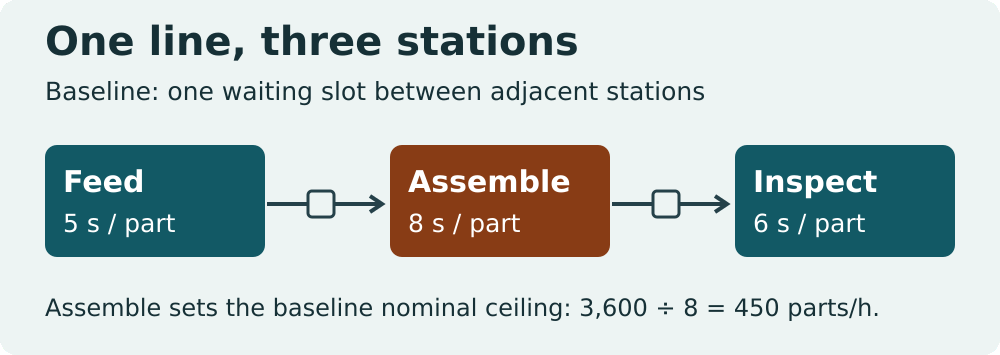
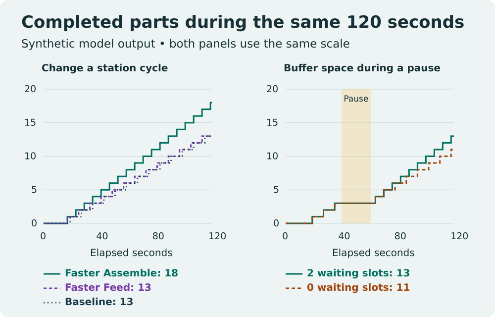

# Production Line Bottleneck Analysis in Python

Compare five synthetic runs of a three-station line. The model reports completed parts, waiting inventory and time each station spends working, blocked, starved or offline. No machine connection is required.

[Full WIFA Robotics lesson](https://wifarobotics.com/learn/production-line-bottleneck-analysis/)

## Run from zero

1. Install [Python 3.10 or later](https://www.python.org/downloads/). On Windows, the commands below can use `py -3` in place of `python3`.
2. On the GitHub repository page, choose **Code > Download ZIP**, extract it, and open a terminal in the directory containing `line.py`. If you already have Git, cloning the repository is equivalent.
3. Check `python3 --version` and run the commands below. No packages need to be installed.

```sh
python3 line.py examples/baseline.json
python3 line.py examples/faster-feed.json
python3 line.py examples/faster-assemble.json
python3 line.py examples/inspection-pause-zero.json
python3 line.py examples/inspection-pause-two.json
python3 -m unittest discover -s tests -v
```

| Example | Completed in 120 s | Equivalent parts/h | Clue to inspect |
| --- | ---: | ---: | --- |
| baseline | 13 | 390 | Feed is blocked for 37 s |
| faster-feed | 13 | 390 | Feed is blocked for 69 s |
| faster-assemble | 18 | 540 | Inspect now shares the six-second nominal constraint |
| inspection-pause-zero | 11 | 330 | Assemble is blocked for 19 s |
| inspection-pause-two | 13 | 390 | Assemble is blocked for 3 s |

`stations` lists `[name, seconds per part]` pairs in flow order. `buffers` lists waiting slots between adjacent stations, excluding the parts held at the stations. A size of zero permits direct handoff but no waiting slot. A pause such as `["Inspect", 40, 61]` pauses work for seconds 40 through 60; a partially processed part resumes with its remaining work at second 61.

Every run starts empty with unlimited input and immediate output collection. A completion at exactly the window end counts; transfers and admission at that boundary do not occur. The observed hourly number scales a short run and should not be treated as measured hourly capacity. The isolated bound ignores starvation and blocking. Check conservation with `admitted = completed + unfinished`.





## Troubleshooting

- **Can't open file:** list the current directory; it should contain `line.py` and `examples`.
- **Invalid JSON or duplicate key:** copy a supplied example and edit only one integer. Use double quotes and omit trailing commas.
- **Zero completions:** compare the horizon with the sum of the first part's cycle times, including any pauses it encounters. Zero output can be correct.
- **Unexpectedly identical output:** compare completion timestamps, blocking and buffer peaks, then change one setting at a time.
- **Working + blocked + starved + offline looks different from a machine dashboard:** offline takes precedence in this model; each second counts once.

The simulator is deterministic. It does not model defects, rework, takt or customer demand, operator availability, randomized failures, batch transfers or fractional seconds. It neither reads from nor writes to a PLC. To compare it with a real line, begin with authorized, read-only timestamp data and check whether its assumptions fit.

`diagrams/render.py` regenerates the editable SVG figures from code and the five examples. Rendering the SVGs to WebP is optional for readers: from this directory, use `python3 diagrams/render.py`, then for each SVG run `inkscape diagrams/NAME.svg --export-filename=/tmp/NAME.png` and `cwebp -lossless /tmp/NAME.png -o diagrams/NAME.webp` where those rendering tools are installed. Neither tool is needed for the simulator.

References: [MIT Manufacturing Systems Analysis: Transfer Lines](https://ocw.mit.edu/courses/2-852-manufacturing-systems-analysis-spring-2010/00f767946947aca163c372381f8bdaf3_MIT2_852S10_transfer_lines.pdf), [NIST SimPROCESD](https://www.nist.gov/services-resources/software/simprocesd), [Python unittest](https://docs.python.org/3/library/unittest.html).
